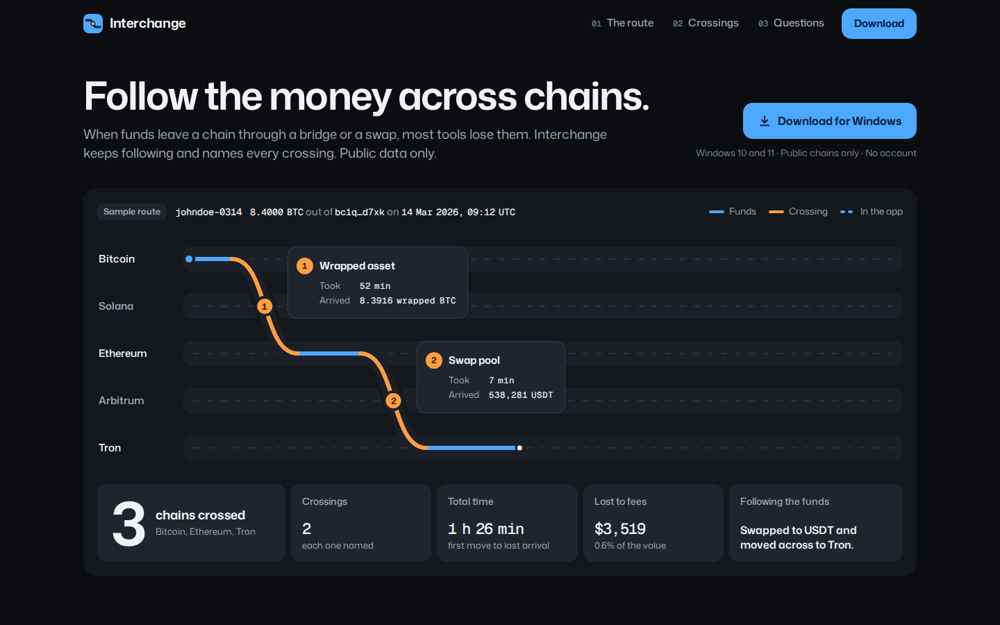
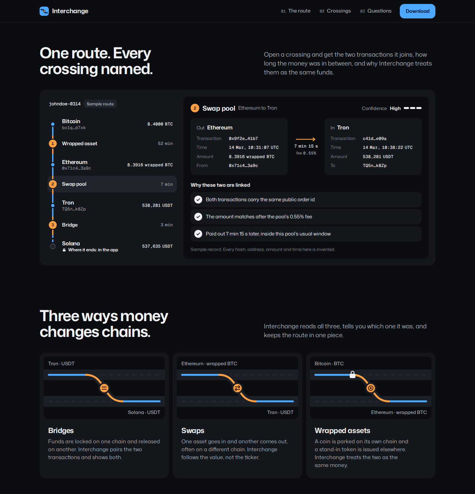
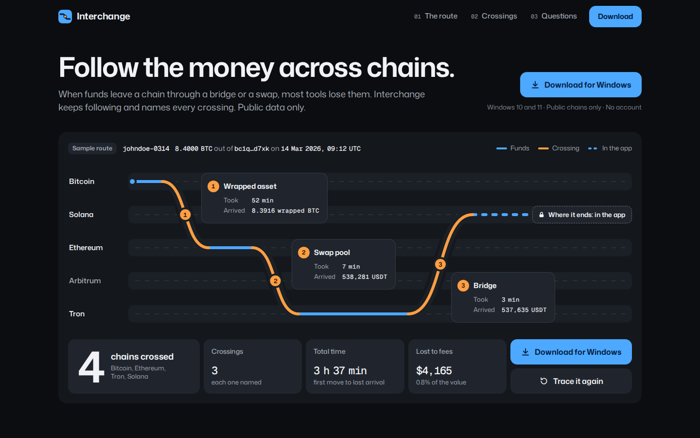

<h1 align="center">Interchange: OSINT cross-chain crypto tracing</h1>

<b>Follow the money across chains.</b> One continuous route for funds that hop between blockchains, with every bridge and swap on the way named.

OSINT · OSINT tool · cross-chain tracing · crypto tracing · blockchain analysis · bridge tracing · follow the money · windows

> **Status: v2.5.4.** The app is out — [download Interchange for Windows](https://awesomeosint.tools/interchange/).

## Why this exists

Funds do not respect chains. A wallet starts on one network, hops a bridge, comes back wrapped — and the trail goes cold in the explorer.

## Why it is different

Explorers stop at the edge of their chain. Interchange follows the hop, names the bridge, unwraps the asset and keeps going — one route, every chain, public data only.

## The idea

- **One object.** A motorway interchange seen from above: lanes that cross and merge. Every lane is a chain.
- **One number.** How many chains the route crosses. The sample route crosses 4.
- **Colour.** Asphalt `#0B0D10` and white. Azure `#4DA8FF` is the funds on their way to the next crossing, and the download. Tangerine `#FF9F43` is the crossing itself. Nothing else wears them.
- **The main feature.** The route: one continuous line for the money across chains, with every crossing named: what kind it was, how long it took and how much arrived.

## The demo on the page

The lane map draws one sample route from left to right. 8.4 BTC leaves a Bitcoin address, is wrapped onto Ethereum, swapped across to Tron and bridged to Solana. Each crossing gets a numbered node and a card with its kind, the time it took and the amount that arrived, and the strip under the lanes counts chains crossed, crossings, total time and value lost to fees. Then it stops: the stretch on the last lane is dashed, its end is a locked plate that says "Where it ends: in the app", and the strip offers the download and "Trace it again". The run waits while the map is off screen or the tab is hidden, and with reduced motion it shows the finished state at once.

Further down, the route sheet lists the same route top to bottom; its three crossings are buttons that open the record of each one.

